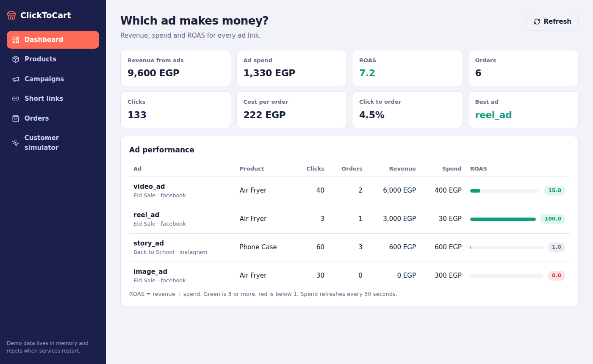
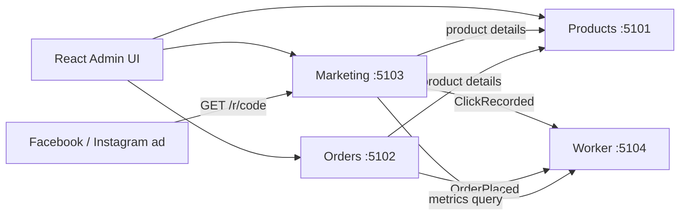
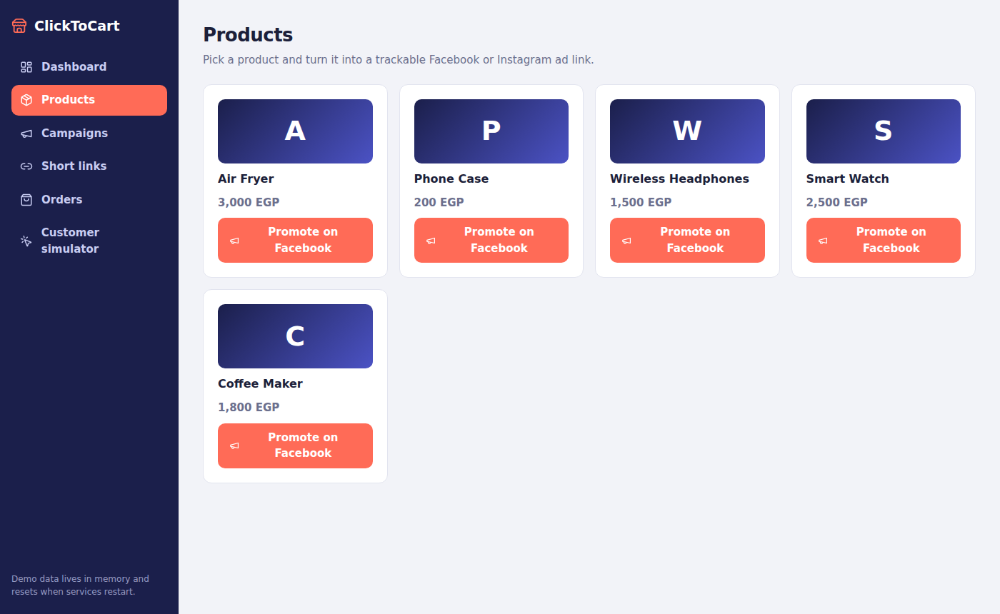
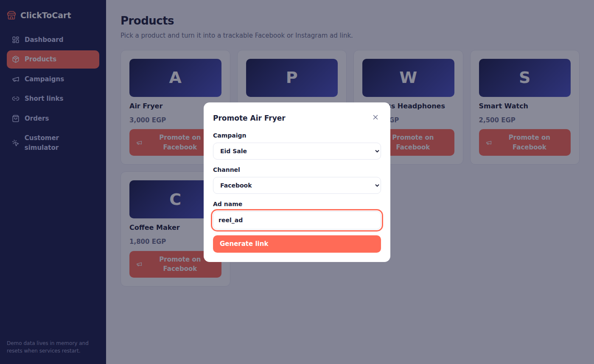
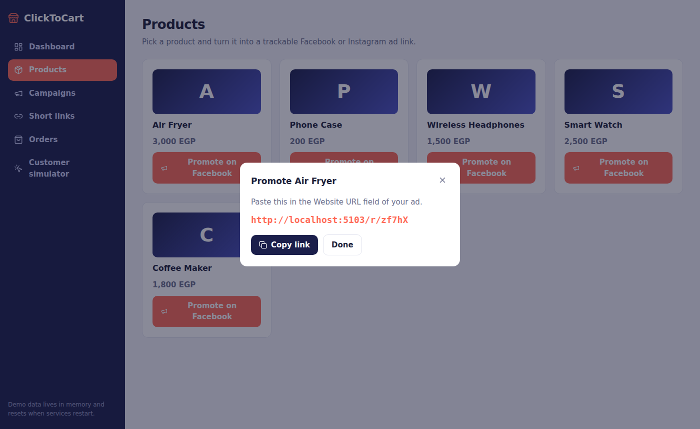
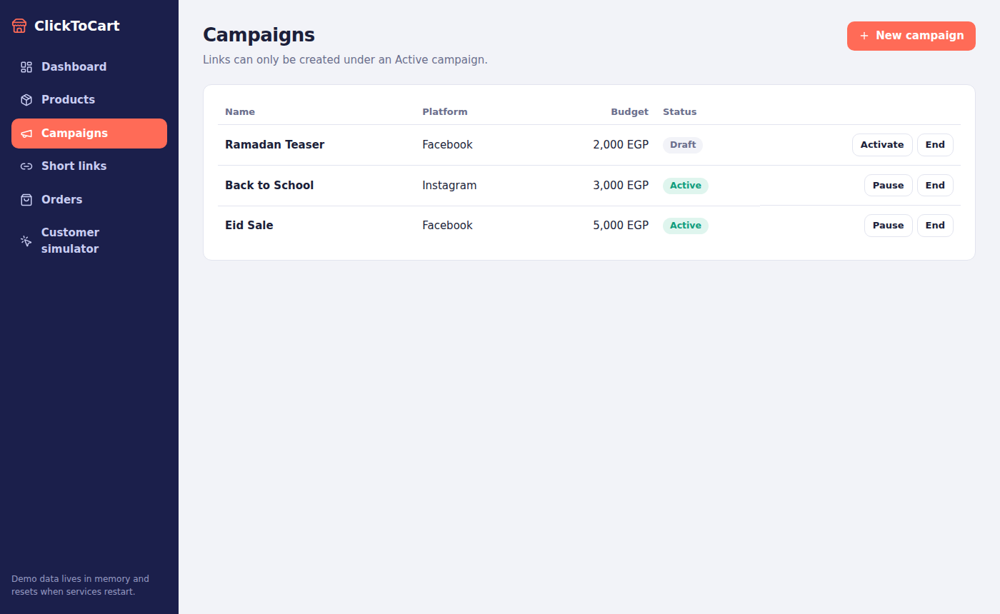
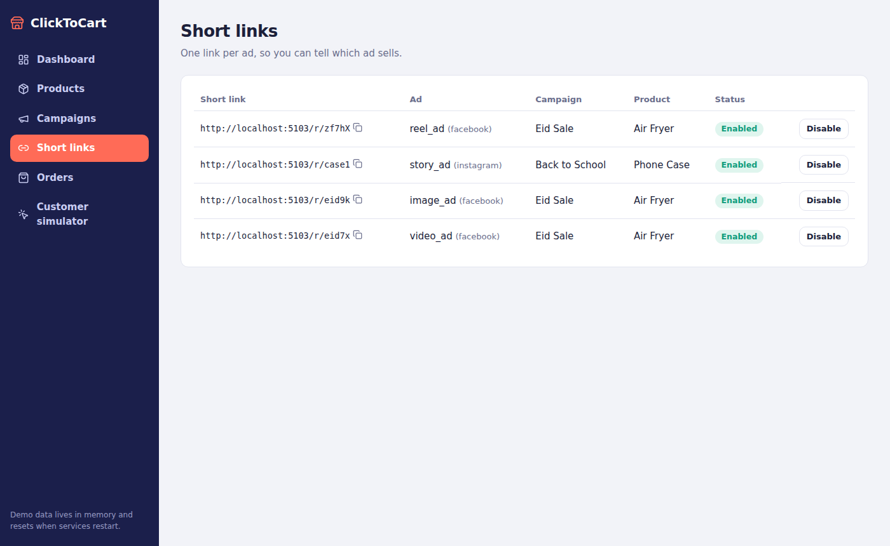
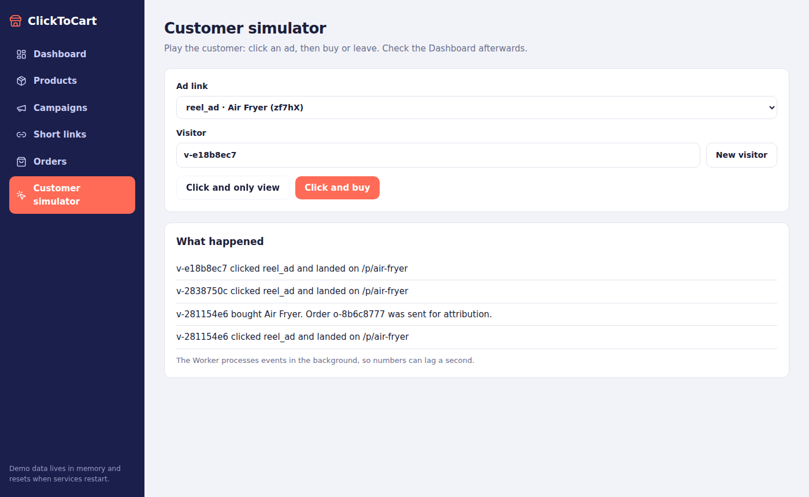
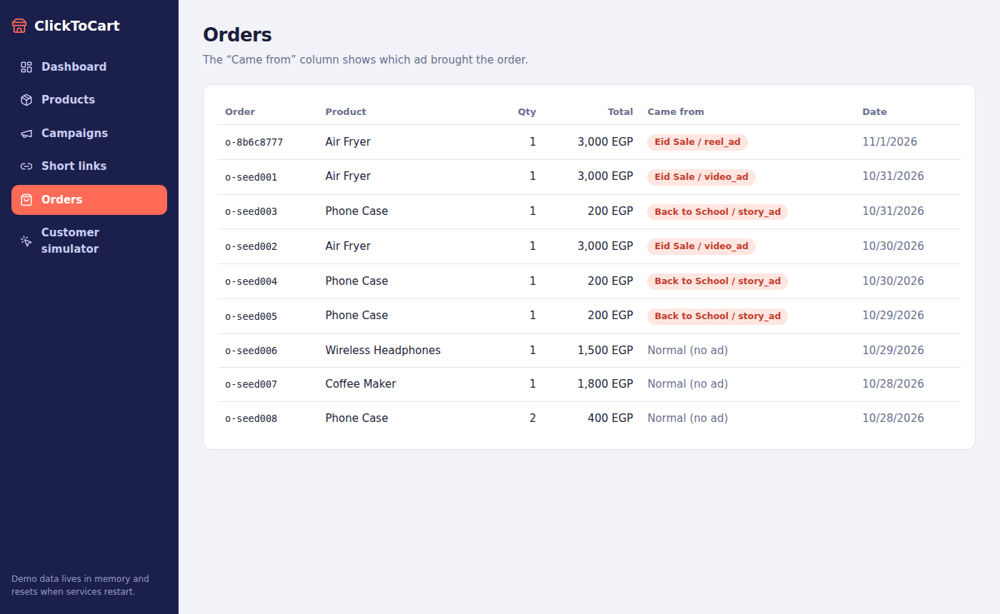

# ClickToCart

**Find out which Facebook and Instagram ad actually makes money.**
An admin picks a product, generates a tracked short link for an ad, and sees clicks, orders, revenue, and ROAS for every ad.

`.NET 8 / 10` · `Clean Architecture` · `SOLID` · `Serilog` · `React + Vite` · `In-memory seed data`



## Contents

1. [The business problem](#1-the-business-problem)
2. [The solution at a glance](#2-the-solution-at-a-glance)
3. [Walkthrough: business, then code, then screen](#3-walkthrough)
   - [3.1 Products and Promote](#31-products-and-promote)
   - [3.2 Campaigns](#32-campaigns)
   - [3.3 Short links and the redirect](#33-short-links-and-the-redirect)
   - [3.4 Customer simulator](#34-customer-simulator)
   - [3.5 Orders and attribution](#35-orders-and-attribution)
   - [3.6 Dashboard](#36-dashboard)
4. [Solution structure and SOLID](#4-solution-structure-and-solid)
5. [Logging](#5-logging)
6. [Run it](#6-run-it)
7. [What is simulated](#7-what-is-simulated)

---

## 1. The business problem

An online shop pays Facebook for every click on an ad. A click is a **cost**. It only turns into **revenue** if that person later buys.

Most shops can see "50 people clicked" and "5 orders today" but cannot say **which ad** produced those orders. So they keep paying for ads that never sell.

| Example: Ahmed's phone case shop | |
|---|---|
| Ad spend | 100 EGP (50 clicks × 2 EGP) |
| Buyers | 5 × 200 EGP = 1,000 EGP revenue |
| **ROAS** (revenue ÷ spend) | **10** |
| Cost per order | 20 EGP |

If Ahmed runs two ads and cannot tell which one made the 5 sales, he cannot decide where to put his next 100 EGP. ClickToCart solves exactly that.

## 2. The solution at a glance

Every ad gets **its own short link**. The link remembers who clicked. When that person buys, the order is tied back to the ad.



| Service | Port | Business job | Technical job |
|---|---|---|---|
| **Products** | 5101 | Knows what the shop sells | Catalog API |
| **Orders** | 5102 | Takes orders and remembers which ad sent the buyer | Order API, publishes `OrderPlaced` |
| **Marketing** | 5103 | Where the admin plans ads and reads results | Campaigns, links, redirect, reporting |
| **Worker** | 5104 | Quietly does the bookkeeping | Click ingest, attribution, ad-spend sync |

```
Admin creates link ─► Facebook ad ─► Customer clicks ─► Redirect logs click + sets cookie
                                                              │
                                              Shop product page ─► Customer buys
                                                              │
                          Order saved with the link code ─► Worker attributes it ─► Dashboard
```

---

## 3. Walkthrough

Each part below follows the same order: **business** (why it exists), **code** (how it works), **screen** (what the admin sees).

### 3.1 Products and Promote

**Business.** The admin already sells products. Instead of typing product URLs by hand, they pick a product, press **Promote on Facebook**, choose a campaign and an ad name, and get a short link to paste into Facebook Ads Manager. One link per ad is the key idea: it is what lets the dashboard compare ads.

**Code.** The Products service owns the catalog. Marketing never reads its data. It asks over HTTP through a port, so the product database could change without touching Marketing.

```csharp
// Marketing/Application/LinkService.cs
public async Task<LinkDto> CreateAsync(CreateLinkRequest request, CancellationToken ct)
{
    var campaign = await campaigns.FindAsync(request.CampaignId, ct)
        ?? throw new NotFoundException("Campaign", request.CampaignId);
    var product = await catalog.GetAsync(request.ProductId, ct);
    var link = ShortLink.Create(await NextFreeCodeAsync(ct), campaign, ToSnapshot(product),
        request.Channel, request.AdName, clock.GetUtcNow().UtcDateTime);
    await links.AddAsync(link, ct);
    logger.LogInformation("Link {Code} created: campaign {Campaign}, product {Product}, ad {Ad}",
        link.Code, campaign.Name, link.ProductName, link.AdName);
    return Mappers.ToDto(link, BaseUrl);
}
```

The final product URL gets UTM tags so analytics tools can see where traffic came from. This is a pure function with no dependencies:

```csharp
// Marketing/Domain/UtmBuilder.cs
public static string Build(string pageUrl, string channel, string campaign, string ad)
{
    var tags = new Dictionary<string, string>
    {
        ["utm_source"] = Slug(channel), ["utm_medium"] = "paid",
        ["utm_campaign"] = Slug(campaign), ["utm_content"] = Slug(ad)
    };
    var separator = pageUrl.Contains('?') ? '&' : '?';
    return pageUrl + separator + string.Join('&', tags.Select(t => $"{t.Key}={t.Value}"));
}
// https://shopeg.com/p/air-fryer?utm_source=facebook&utm_medium=paid&utm_campaign=eid_sale&utm_content=reel_ad
```

**Screens.**

Products page, one card per product:



Promote form, with the product already filled in:



The generated short link, ready to paste into the ad:



---

### 3.2 Campaigns

**Business.** A campaign groups ads under one goal and budget, such as "Eid Sale". Admins need to start, pause, and end campaigns without losing history. Pausing is how you stop spending: clicks on a paused campaign no longer reach the product page.

**Code.** The rules live inside the `Campaign` entity, not in the service or the UI, so no code path can break them:

```csharp
// Marketing/Domain/Campaign.cs   Draft -> Active <-> Paused -> Ended
public void Activate() => MoveTo(CampaignStatus.Active, CampaignStatus.Draft, CampaignStatus.Paused);
public void Pause()    => MoveTo(CampaignStatus.Paused, CampaignStatus.Active);
public void End()      => MoveTo(CampaignStatus.Ended, CampaignStatus.Draft, CampaignStatus.Active, CampaignStatus.Paused);

private void MoveTo(CampaignStatus target, params CampaignStatus[] allowedFrom)
{
    if (!allowedFrom.Contains(Status))
        throw new DomainException($"A {Status} campaign cannot become {target}.");
    Status = target;
}
```

The service maps the action name to a method through a dictionary. Adding a new action does not require editing a `switch`:

```csharp
// Marketing/Application/CampaignService.cs
private static readonly Dictionary<string, Action<Campaign>> StatusActions = new(StringComparer.OrdinalIgnoreCase)
{
    ["activate"] = c => c.Activate(),
    ["pause"]    = c => c.Pause(),
    ["end"]      = c => c.End()
};
```

A link can only be created under an **Active** campaign (`ShortLink.Create` throws otherwise). The global error handler turns that into a clean 400 response for the UI.

**Screen.** Status badges and the actions allowed for each status:



---

### 3.3 Short links and the redirect

**Business.** The short link is what goes into the Facebook ad. When a customer clicks it, three things must happen fast: count the click, remember the visitor, and send them to the product. If the campaign is paused or the link is disabled, the visitor goes to the home page instead of an error, so paid clicks are not wasted.

**Code.** The redirect is a thin endpoint. It reads the visitor cookie, asks the service what to do, sets the 7-day cookie, and returns a 302. A 302 (not 301) is used so browsers never cache it and every click is counted.

```csharp
// Marketing/Api/RedirectEndpoints.cs
private static async Task<IResult> RedirectAsync(string code, HttpContext http, IRedirectService redirects, CancellationToken ct)
{
    var click = new ClickContext(code, http.Request.Cookies[CookieName], http.Request.Query["fbclid"].FirstOrDefault());
    var result = await redirects.ResolveAsync(click, ct);
    AppendCookie(http, result.VisitorId);
    return Results.Redirect(result.TargetUrl);
}
```

```csharp
// Marketing/Application/RedirectService.cs
public async Task<RedirectResult> ResolveAsync(ClickContext click, CancellationToken ct)
{
    var link = await links.FindAsync(click.Code, ct) ?? throw new NotFoundException("Link", click.Code);
    var campaign = await campaigns.FindAsync(link.CampaignId, ct) ?? throw new NotFoundException("Campaign", link.CampaignId);
    var visitorId = click.VisitorId ?? NewVisitorId();

    if (!link.CanRedirect(campaign)) return Fallback(link, visitorId);   // paused or disabled

    await PublishClickAsync(link, visitorId, click.Fbclid, ct);            // event to the Worker
    return new RedirectResult(link.FinalUrl, visitorId);
}
```

The click is sent to the Worker as an event, so the redirect never waits for storage. The publisher sits behind an interface, so HTTP can be replaced by RabbitMQ or Kafka without touching callers:

```csharp
// Shared/Messaging/IEventPublisher.cs
public interface IEventPublisher
{
    Task PublishAsync<TEvent>(TEvent integrationEvent, CancellationToken ct = default) where TEvent : IIntegrationEvent;
}
```

**Screen.** Every link with its ad, campaign, product, and a Disable action:



---

### 3.4 Customer simulator

**Business.** In real life, customers click ads on Facebook. For a demo (and for interviews) you need to play the customer yourself. The simulator lets you click an ad link, then either leave (a click that costs money and earns nothing) or buy.

**Code.** The simulator uses the same code paths as real traffic. Clicking calls the redirect service. Buying calls the Orders API with the link code and visitor id, exactly what a shop front end would send from the cookie:

```csharp
// Orders/Application/OrderService.cs
public async Task<OrderDto> CreateAsync(CreateOrderRequest request, CancellationToken ct)
{
    var order = await BuildOrderAsync(request, ct);
    await repository.AddAsync(order, ct);
    logger.LogInformation("Order {OrderId} created: {Product} x{Qty} = {Total} (ad link: {Link})",
        order.Id, order.ProductName, order.Quantity, order.Total, order.Ad?.LinkCode ?? "none");
    await PublishPlacedAsync(order, ct);        // OrderPlaced event to the Worker
    return OrderMapper.ToDto(order);
}
```

Normal orders (no ad) work the same way. Their ad fields are simply empty, so existing shop behavior is unchanged.

**Screen.** One buyer and two visitors who looked and left:



---

### 3.5 Orders and attribution

**Business.** This is the core of the product: deciding **which ad deserves credit for a sale**. The rule is simple and fair: an order counts for an ad only if the same visitor clicked that ad within the last **7 days**. An order from someone who never clicked the ad is not credited to it. The Orders page then shows a **Came from** column so the admin can see the source of each order.

**Code.** The Worker's `AttributionHandler` checks the rules in small steps and is idempotent, so a repeated event cannot count a sale twice:

```csharp
// Worker/Application/AttributionHandler.cs
protected override async Task HandleEventAsync(OrderPlacedEvent e, CancellationToken ct)
{
    if (!IsAdOrder(e)) return;                                   // normal order, nothing to do
    if (orders.Exists(e.OrderId)) { logger.LogInformation("Order {OrderId} already attributed", e.OrderId); return; }
    if (!HasValidClick(e)) { logger.LogInformation("Order {OrderId} has no click inside the window", e.OrderId); return; }

    await AttributeAsync(e, ct);
}
```

```csharp
// Worker/Domain/Records.cs   the business rule, in one place
public static class AttributionPolicy
{
    public static readonly TimeSpan Window = TimeSpan.FromDays(7);

    public static bool IsWithinWindow(DateTime clickedAt, DateTime orderedAt)
    {
        var elapsed = orderedAt - clickedAt;
        return elapsed >= TimeSpan.Zero && elapsed <= Window;
    }
}
```

New Worker features plug in without editing the dispatcher. A handler only declares which event type it cares about:

```csharp
// Worker/Application/IntegrationEventHandler.cs
public abstract class IntegrationEventHandler<TEvent> : IEventHandler where TEvent : IIntegrationEvent
{
    public bool CanHandle(IIntegrationEvent e) => e is TEvent;
    public Task HandleAsync(IIntegrationEvent e, CancellationToken ct) => HandleEventAsync((TEvent)e, ct);
    protected abstract Task HandleEventAsync(TEvent integrationEvent, CancellationToken ct);
}
```

**Screen.** Ad orders carry a "Came from" badge. Normal orders say "Normal (no ad)":



---

### 3.6 Dashboard

**Business.** The question the whole system exists to answer: **which ad makes money?** For each ad the dashboard shows clicks, orders, revenue, spend, and **ROAS** (revenue ÷ spend). Green means 3 or more, red means below 1. In the screenshot, `reel_ad` (3 clicks, 1 order) is the best ad and `image_ad` (30 clicks, 0 orders) is wasting money, so the budget should move.

**Code.** Marketing owns the campaigns and links. The Worker owns clicks, attributed orders, and spend. The reporting service joins them. The formulas are tiny pure functions:

```csharp
// Marketing/Application/Kpi.cs
public static decimal Roas(decimal revenue, decimal spend) => Ratio(revenue, spend);
public static decimal Cpa(decimal spend, int orders) => Ratio(spend, orders);
public static decimal ConversionRate(int orders, int clicks) => Ratio(orders, clicks);
private static decimal Ratio(decimal top, decimal bottom) => bottom == 0 ? 0 : Math.Round(top / bottom, 4);
```

If the Worker is down, the dashboard still loads with zeros instead of failing:

```csharp
// Marketing/Application/ReportingService.cs
private async Task<Dictionary<string, LinkMetricsDto>> LoadMetricsAsync(CancellationToken ct)
{
    try { return (await metricsClient.GetLinkMetricsAsync(ct)).ToDictionary(m => m.LinkCode); }
    catch (Exception ex)
    {
        logger.LogWarning(ex, "Worker metrics unavailable; showing zeros");
        return [];
    }
}
```

Ad spend comes from the **Ad Sync** job, which runs every 30 seconds through a port that a real Meta Marketing API client can implement:

```csharp
// Worker/Application/AdSyncService.cs
foreach (var (linkCode, count) in clicksByLink)
    spendStore.Set(linkCode, await provider.GetSpendAsync(linkCode, count, ct));
```

**Screen.** The full dashboard is shown at the top of this README.

---

## 4. Solution structure and SOLID

```
ClickToCart.sln
├── src/
│   ├── BuildingBlocks/ClickToCart.Shared/   events, contracts, error handling, logging, Swagger, CORS
│   └── Services/
│       ├── Products/   Orders/   Marketing/   Worker/
│           ├── Domain/          entities and business rules (no dependencies)
│           ├── Application/     use cases, DTOs, ports (interfaces)
│           ├── Infrastructure/  in-memory repositories, HTTP clients, background jobs, seed data
│           ├── Api/             minimal API endpoints
│           ├── DependencyInjection.cs
│           └── Program.cs
├── web/admin-ui/        React + Vite admin dashboard
├── docs/images/         screenshots used in this README
└── scripts/run-all.sh
```

Dependencies point inward: `Api → Application → Domain`, and `Infrastructure → Application`. Application code only knows interfaces.

| Principle | Where to look |
|---|---|
| **Single responsibility** | `ClickIngestHandler`, `AttributionHandler`, `AdSyncService`, `MetricsQuery`, `Kpi`, `UtmBuilder` each do one job |
| **Open/closed** | New Worker features are new `IntegrationEventHandler<T>` classes. Campaign actions use a dictionary, not a growing `switch` |
| **Liskov** | Any `IOrderRepository`, `IEventQueue` or `IAdSpendProvider` can replace another without changing callers |
| **Interface segregation** | Small ports such as `ICodeGenerator`, `IMetricsClient`, `IProductCatalog`, `IAdSpendStore` |
| **Dependency inversion** | Services depend on interfaces. Implementations are wired only in each `DependencyInjection.cs` |

Other practices: small single-purpose methods, rules inside entities, constructor injection with primary constructors, and `TimeProvider` instead of `DateTime.UtcNow` in services.

## 5. Logging

All services use **Serilog**, configured once in `ClickToCart.Shared`, writing to the console and to a daily file in each service's `logs/` folder (for example `logs/worker-20261101.log`).

Example of what a click-and-buy leaves behind across services (messages from a real run):

```
[INF] marketing | Link zf7hX created: campaign Eid Sale, product Air Fryer, ad reel_ad
[INF] worker    | Click stored: link zf7hX, visitor v-281154e6
[INF] orders    | Order o-8b6c8777 created: Air Fryer x1 = 3000 (ad link: zf7hX)
[INF] worker    | Order o-8b6c8777 (3000) attributed to link zf7hX
[INF] worker    | [Meta CAPI simulated] Purchase event: order o-8b6c8777, value 3000 EGP, link zf7hX
[INF] worker    | Ad spend synced for 4 links
```

A global exception handler returns consistent JSON errors: 400 for rule violations, 404 for missing items, 500 for unexpected failures. Warnings and errors are logged with details.

## 6. Run it

Requirements: .NET SDK (8 or 10) and Node 18 or newer.

```bash
./scripts/run-all.sh
```

Or run each part in its own terminal:

```bash
dotnet run --project src/Services/Products
dotnet run --project src/Services/Orders
dotnet run --project src/Services/Marketing
dotnet run --project src/Services/Worker
cd web/admin-ui && npm install && npm run dev
```

Open **http://localhost:5173**. Each service also exposes Swagger at `/swagger`.

**Try the demo in 2 minutes**

1. **Products** → *Promote on Facebook* on the Air Fryer → generate a link.
2. **Customer simulator** → *Click and buy*, then *New visitor* → *Click and only view*.
3. **Orders** → the new order shows *Came from: Eid Sale / reel_ad*.
4. **Dashboard** → wait up to 30 seconds for ad spend, then compare the ads.
5. **Campaigns** → pause the campaign and click the link again. The visitor now goes to the fallback page.

| Service | Main endpoints |
|---|---|
| Products | `GET /api/products`, `GET /api/products/{id}` |
| Orders | `GET /api/orders`, `POST /api/orders` |
| Marketing | `GET/POST /api/campaigns`, `POST /api/campaigns/{id}/status/{activate\|pause\|end}`, `GET/POST /api/links`, `POST /api/links/{code}/disable`, `GET /api/dashboard`, `GET /r/{code}`, `POST /api/simulator/click` |
| Worker | `POST /events/click-recorded`, `POST /events/order-placed`, `GET /api/metrics/links` |

## 7. What is simulated

No database is created. Every repository is a thread-safe in-memory class with seed data, and everything resets when a service restarts.

| Simulated here | A production version would use |
|---|---|
| In-memory repositories | MongoDB or SQL behind the same interfaces |
| HTTP event publishing to the Worker | RabbitMQ or Kafka with an outbox so no event is lost |
| `FakeAdSpendProvider` (10 EGP per click) | Meta Marketing API client |
| `LoggingMetaConversionsClient` | Meta Conversions API with hashed user data |
| No login | JWT and roles (SuperAdmin, CampaignManager, Analyst) |
| Redirect inside Marketing | Redirect as its own service behind a load balancer with a Redis link cache |

